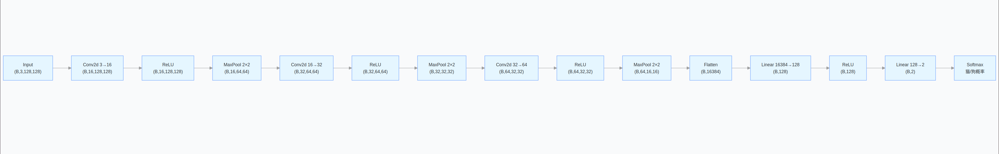

### 2.1 数据集观察 Kaggle Dogs vs Cats

数据集：PetImages 文件夹一共 25000 张，猫 12500 张，狗 12500 张。

图片特点：原始图片**尺寸不统一、清晰度差别较大**；拍摄背景各不相同，包含室内、户外、草地等场景；有的是头部特写，有的是全身照，物体位置不固定。

随机采样可视化：随机选取若干图片展示，可以直观看到图片分辨率、构图、背景差异。
### 2.2 batch

`torch.utils.data.DataLoader`将样本打包成 batch：
- 训练集`shuffle=True`打乱顺序；验证 / 测试集`shuffle=False`；
- 输出张量形状`[B, C, H, W]`，B 为 batch 大小；

### 2.4 单张图片逐层 Tensor Shape 记录

输入张量：`[1, 3, 128, 128]`（B=1，C=3，H=128，W=128）

1. Conv2d(3,16,3,padding=1)：`[1,16,128,128]`，**通道数由 3 变为 16，高宽不变**；
2. ReLU：`[1,16,128,128]`，仅做非线性映射，维度不变；
3. MaxPool2d(2,2)：`[1,16,64,64]`，高、宽减半，通道不变；
4. Conv2d(16,32,3,padding=1)：`[1,32,64,64]`，通道提升至 32；
5. ReLU：维度不变；
6. MaxPool2d(2,2)：`[1,32,32,32]`，高宽继续减半；
7. Conv2d(32,64,3,padding=1)：`[1,64,32,32]`，通道提升至 64；
8. ReLU：维度不变；
9. MaxPool2d(2,2)：`[1,64,16,16]`，高宽变为 16×16；
10. Flatten：`[1, 64*16*16]`，把空间维度展平；
11. Linear 层：逐步映射到 2 维输出。

### 2.5 卷积特征图可视化

选取**第一层卷积**输出的特征图可视化，观察不同通道输出：

1. 浅层卷积通道，大多提取**边缘、轮廓、线条、简单纹理**；部分通道对明暗变化敏感；
2. 每个通道对应一组独立卷积核，每个卷积核负责捕捉一种局部图像模式；
3. 并不是所有通道可视化效果都明显，部分通道学习比较抽象的灰度变化；深层卷积会把底层边缘纹理组合成高级特征（五官、动物轮廓）。

> 
> 结论：浅层网络关注底层视觉信息（边缘、纹理）；深层网络学习语义相关的抽象特征。

### 2.6 图像变换

#### 合理的图像变换

1. **随机水平翻转**：猫狗左右翻转后类别标签不变，可以扩充样本，提升模型鲁棒性；
2. **随机裁剪**：模拟目标在画面中位置偏移，强迫模型学习物体主体特征，不依赖固定位置；
3. **轻微颜色抖动**：模拟拍摄光照变化，提升模型在不同亮度环境下的识别能力。

#### 不合理、会破坏标签的变换

1. 垂直翻转：猫狗几乎不会倒立，图像内容失真；
2. 大幅度旋转：物体姿态异常，脱离真实场景；
3. 极强色彩扰动：严重失真，丢失物体真实颜色信息；
4. 随机擦除过大区域：主体被遮挡，样本失去有效信息。

### 2.7 错误样本分析与模型改进

#### 预测错误样本常见原因

1. 目标遮挡、极端角度：猫狗侧脸、头部被遮挡，特征不完整；
2. 图像质量差：图片模糊、分辨率低；
3. 背景干扰强：复杂背景和动物特征混杂；
4. 外观近似：部分小猫小狗外观相似度高，人眼也容易混淆；
5. 数据集样本不均衡或者困难样本数量不足；
6. 模型容量不足，拟合能力有限，或者出现过拟合。

####  改进方案

1. 扩充训练集，增加困难样本；
2. 在网络中增加 Dropout 层，加入正则缓解过拟合；
3. 使用迁移学习，基于预训练 CNN 权重做微调；
4. 调整图片分辨率，增加模型输入信息；
5. 优化数据增强策略，保留有效变换，去掉失真变换；
6. 调整学习率、训练 epoch，使用学习率衰减。

### 2.9 模型结构图

