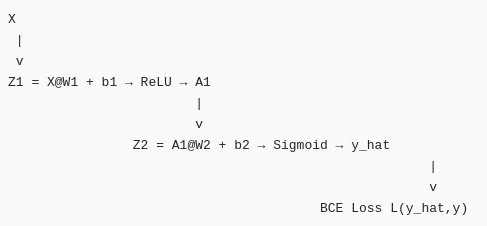

## 1. 前向传播时为什么要保存每一层的输入或输出？反向传播会在哪里用到它们？这和显存有什么关系？

### 核心结论

反向传播用**链式法则**，计算某一层梯度**必须依赖该层前向时的激活输出 / 预激活值**，不能只靠损失和参数。

> 
> 例：代码里 sigmoid 的导数 \(\sigma'(z_1)=\sigma(z_1)(1-\sigma(z_1))\)，计算 \(dL/dz_1\) 必须用到前向算出的 \(h_1=\sigma(z_1)\)。**只保存权重不够，必须保存中间激活。**

- 在哪里使用：
  1. 计算激活函数导数：需要该层预激活 \(z_1\) 或激活输出 \(h_1\)
  2. 计算权重梯度：\(dL/dW_1 = dL/dz_1^\top @ X\)，需要本层输入 X；\(dL/dW_2 = dL/d\hat y^\top @ h_1\)，需要隐藏层输出\(h_1\)
  3. 偏置梯度：需要该层的上游梯度 \(dL/dz\)，沿 batch 求和
- 和显存（内存）的关系：
PyTorch autograd 会在计算图上**缓存这些中间张量（activations）** 放在显存里。
- 优点：反向传播直接读取缓存，不用重新计算前向，速度快；
- 代价：**占用显存**。网络越深、batch 越大，缓存的中间结果越多，显存占用越高。

> 
> 可选：`torch.no_grad()` 不构建计算图、不保存中间值；`retain_graph=True` 保留计算图多次 backward；梯度检查点（checkpoint）牺牲计算速度，释放中间缓存省显存。

> 
> 一句话：**前向存中间值 = 以显存换计算速度。**

---

## 2. 链式法则怎样把损失函数的梯度传回第一层权重？

计算图：

链式求导从**最末尾的 Loss 开始，由后向前逐层求导**

\(\frac{\partial \mathcal L}{\partial W_1}=
\frac{\partial \mathcal L}{\partial \hat y}
\cdot \frac{\partial \hat y}{\partial h_1}
\cdot \frac{\partial h_1}{\partial z_1}
\cdot \frac{\partial z_1}{\partial W_1}\)
分步拆解：

1. 最外层：\(\partial \mathcal L/\partial \hat y\)：损失对网络最终预测值的梯度（起点）
2. \(\partial \hat y/\partial h_1 = W_2^\top\)：把梯度回传到隐藏层输出\(h_1\)
3. \(\partial h_1/\partial z_1 = \sigma'(z_1)\)：激活导数，梯度乘上 sigmoid 导数，传到预激活\(z_1\)
4. \(\partial z_1/\partial W_1 = X^\top\)：梯度乘本层输入，得到损失对\(W_1\)的梯度

> 
> 每一步：拿到**上游传来的梯度**，乘当前局部导数，得到传给上一层的梯度。
> 这就是反向传播：梯度信号**从输出端，一层一层逆向流过整个计算图**。

---

## 3. 二元交叉熵与 Sigmoid 配合后，loss 对 logit 的梯度是什么？这个结果为什么方便反向传播？

> 
> Logit：送入 sigmoid 之前的值，z；\(\hat y=\sigma(z)\)
> 二元交叉熵（BCE）：

\(\mathcal L = - \big[y\log\sigma(z)+(1-y)\log(1-\sigma(z))\big]\)

推导结果：

\(\frac{\partial \mathcal L}{\partial z} = \sigma(z)-y = \hat y - y\)

结论：梯度 = sigmoid 输出减标签。

### 为什么极大方便反向传播？

1. **消去了 sigmoid 导数项**。单独 sigmoid 导数会带 \(\sigma(z)(1-\sigma(z))\)；搭配 BCE 损失后，这一项被数学抵消，导数直接简化为 \(\hat y-y\)。
2. 减少数值运算，减少浮点误差；
3. 避免梯度消失：原始 sigmoid 两端梯度很小，单独使用容易梯度消失；BCE+sigmoid 组合缓解这个问题。

> 
> 注意：PyTorch `nn.BCEWithLogitsLoss` 就是把 sigmoid + BCE 合并实现，利用这个化简公式，数值稳定性更好。

---

## 4. NumPy 梯度与 PyTorch 梯度出现差异时，怎样定位问题（区分：公式、矩阵转置、广播、损失求平均）

排查顺序

1. **先检查损失的规约方式**
   - numpy loss 是`sum`还是`mean`？PyTorch 是`reduction="sum"`还是`"mean"`
   - mean 会除以 batch_size，sum 不会；规约不一致直接差一个倍数。
2. **检查矩阵维度、转置顺序**
   - 单样本：\(W@X\)；batch：\(X@W^\top\)。矩阵乘法顺序 / 转置错，梯度形状会完全错乱。
   - 核对每一层张量 shape，看 numpy 和 torch 中间结果 shape 是否匹配。
3. **广播问题**
numpy 广播机制自动扩展维度，容易产生隐式重复计算。比如`(B,1)` 和 `(B,)` 相乘，广播会带来意料之外求和。
对策：所有张量显式用`keepdims=True`，保证维度对齐。
4. **检查求导公式本身**
前面两项没问题，再核对链式推导。例如 sigmoid 导数写错、BCE/MSE 导数写错。

> 
> 调试小技巧：**先使用单样本测试**，去掉 batch，消除 batch 平均和广播干扰；单样本对上了，再扩展到 batch。

---

## 5. 完成两次验证后，如何理解 loss.backward ()？它替我们保存和完成了哪些工作？

`loss.backward()` 是**沿着计算图执行反向传播**。

### 它做的工作：

1. **前向阶段（backward 之前就完成）**：
跟踪所有带`requires_grad=True`张量的运算，**自动构建计算图，缓存每层中间输出 / 激活**，记录每个运算的局部求导规则。
2. **调用 .backward () 时**
   - 从标量 loss 开始，从后往前遍历整张计算图；
   - 使用链式法则，逐层计算梯度；
   - 把算出的梯度累加存入每个参数的 `.grad` 属性；
   - 自动处理张量广播、矩阵求导、维度求和。

### 一句话理解：

只需要写前向计算代码，PyTorch 自动记录计算链路；`backward()` 自动链式求导，算出所有参数梯度，**不用手动推导矩阵求导公式**。

> 
> 局限：只计算图上标记需要求导的张量；默认计算完会释放中间缓存；多次 backward 需要`retain_graph=True`。

---

## 6. 本次实验遇到的报错 & 难点记录

1. Batch 版本矩阵乘法顺序混淆
   - 单样本 \(W_1 @ X\)；batch 需要 \(X @ W_1.T\)，容易写反，梯度 shape 完全错误
2. 损失规约 mean/sum 不一致，numpy 与 torch 梯度差固定倍数（等于 batch size）
3. 容易混淆：**中间张量需要保存，但参数 W/b 不需要在前向额外保存，参数是永久存在的，需要保存的是每层激活输出 z、h**
4. 概念误区：一开始误以为反向传播可以不用前向中间值，后来发现 sigmoid 导数必须依赖前向 h1 的值。
